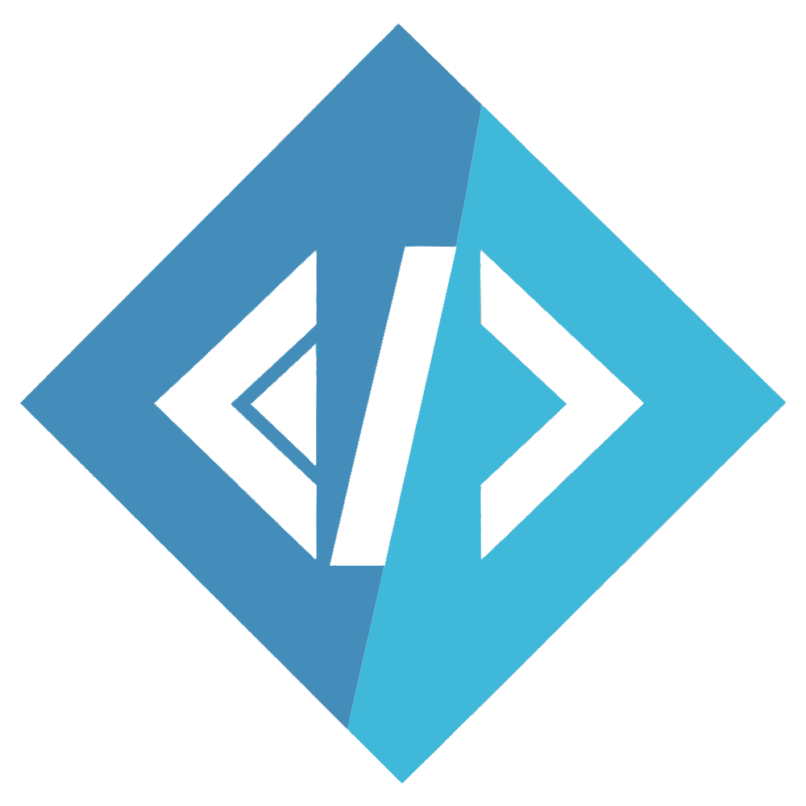

[](https://github.com/meiermade/FSharp.ViewEngine/actions/workflows/release.yml)
[](https://github.com/meiermade/FSharp.ViewEngine/actions/workflows/deploy-staging-docs.yml)
[](https://www.nuget.org/packages/FSharp.ViewEngine)
[](https://www.nuget.org/packages/FSharp.ViewEngine.Cli)

<p align="center">
  
</p>

# FSharp.ViewEngine

A minimal, typed HTML DSL for F#. Build server-rendered HTML with computation expressions, mixing attributes, strings, and child elements in one sequence.

The [Docs site](https://fve.meiermade.com) and [source](https://github.com/meiermade/FSharp.ViewEngine/tree/main/sln/src) are the implementation references. Each [component page](https://fve.meiermade.com/components) includes focused, copyable examples. The [Examples gallery](https://fve.meiermade.com/examples) demonstrates Application, Specification, and API documentation using one [runnable financial application](sln/src/Example/README.md).

## Install

```sh
dotnet add package FSharp.ViewEngine
```

For editable components, install the CLI in your repository:

```sh
dotnet new tool-manifest
dotnet tool install FSharp.ViewEngine.Cli
```

Follow the [component installation guide](https://fve.meiermade.com/components/installation) for project setup and frontend builds. Use `dotnet fve --help` for commands.

## Repository development

Requires the .NET 10 SDK, Node.js/npm, and Tailwind CSS CLI v4.2.2 on `PATH`:

```sh
cd sln
dotnet tool restore
dotnet paket restore
dotnet restore FSharp.ViewEngine.slnx
./fake.sh WatchDocs
```

Use the single catalog watcher at `http://127.0.0.1:5054`; starting it replaces the previous Docs watcher across worktrees.

After editing canonical components in `sln/src/FSharp.ViewEngine.Components`, run `./fake.sh UpdateInstalledComponents` from `sln` to refresh the checked-in Docs and Example consumers. `./fake.sh CheckInstalledComponents` checks drift; `./fake.sh Test` runs tests. Normal builds use installed source without regenerating it.

Pull requests run [Validate PR](.github/workflows/validate-pr.yml); merges run [Deploy staging Docs](.github/workflows/deploy-staging-docs.yml). [Release](.github/workflows/release.yml) previews production and requires approval before publishing selected packages and deploying Docs. For a Docs-only update, manually run [Deploy production Docs](.github/workflows/deploy-production-docs.yml); it previews and requires the same approval without publishing packages.
